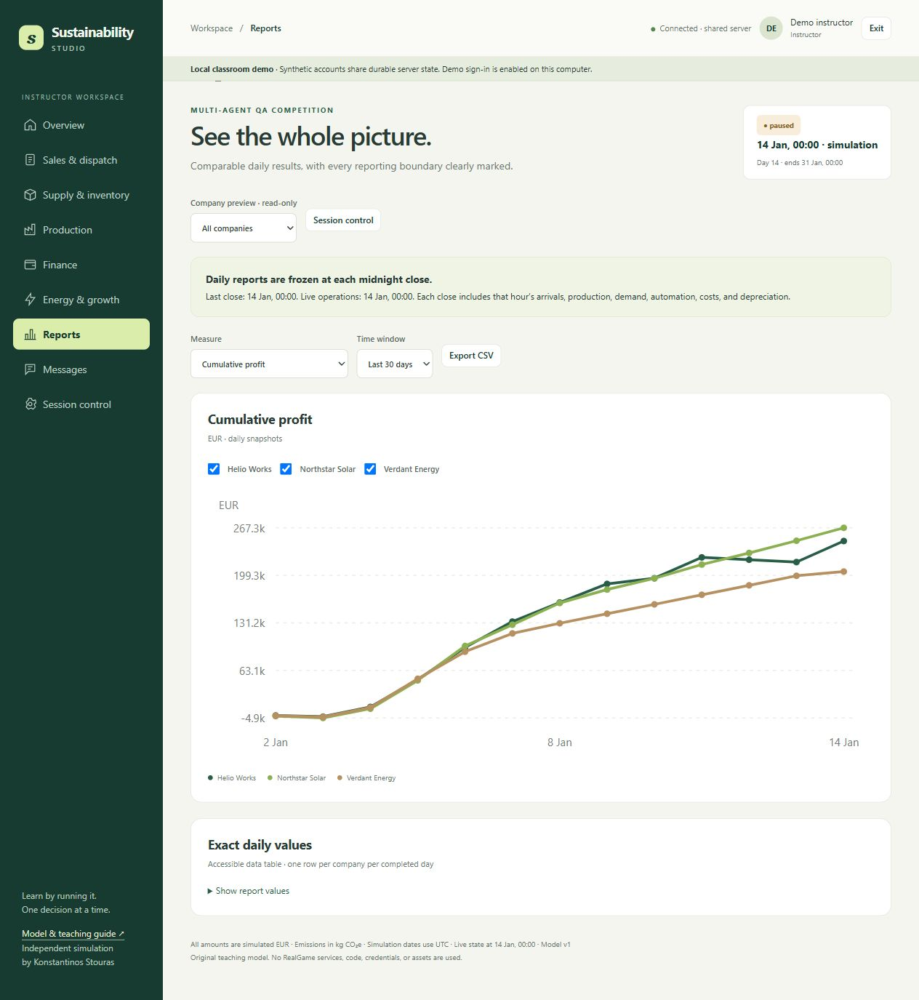

# Multiplayer playtest — 12 November 2026

Two independent student agents played Helio Works and Northstar Solar against the seeded Verdant Energy company. A coordinator operated the instructor workspace, and a third agent audited the engine, persistence and regression tests. This was our original simulation on a local shared server, using synthetic identities and an isolated SQLite database.

The game began after three seeded days. We played ten further days, stopping at 14 January 00:00 with **13 completed daily reports**. Students made decisions between advances to 5, 6, 8 and 14 January. Separate browser tabs shared authoritative server state; they were not independent solo sandboxes.

## Decisions and observed outcomes

| Area | Exercise | Result |
| --- | --- | --- |
| Competition | Helio reduced regional/international offers to EUR 240/250; Northstar chose EUR 330/350 | Different order backlogs and economic outcomes emerged; previously accepted prices stayed fixed |
| Purchasing | Helio bought 12,000 cells, 500 frames and 500 controllers | Deliveries and supplier payments occurred separately; invalid lot sizes were rejected |
| Dispatch | Split an order with a 10-module shipment | The remaining quantity stayed open; delivery and customer payment were separate events |
| Production | Helio used all shifts; Northstar used the evening shift | Production, wages, inventory and daily reports changed as time advanced |
| Finance | Helio borrowed EUR 10,000 for seven days; Northstar deposited EUR 10,000 for one day | Loan funded after 24 hours and repaid with EUR 17.26 interest; deposit returned with EUR 1.10 interest |
| Capacity | Helio added one worker and an assembly line | Staffing and machinery activated after their separate delays, not at purchase |
| Sustainability | Northstar switched to wind and bought an efficiency retrofit | Activation notices appeared and energy costs changed in subsequent reports |
| Automation | Observed replenishment and delivery automation | Incoming stock prevented repeated reordering; shortages remained visible when shared supplier stock could not satisfy the configured batch |
| Administration | Created another session; ran, paused and stepped its clock; changed routes and purchasing permissions | All six student purchase controls became disabled when permission was removed; restoring permission restored access |
| Reporting | Compared profit, production, energy and carbon charts with daily tables | Thirteen immutable daily closes were available; live transactions after a close did not rewrite history |

At the final close, Helio's cumulative profit was approximately EUR 248,413 and Northstar's EUR 267,308. Their cumulative energy costs were EUR 1,097.60 and EUR 552.20 respectively. These are observations from this playtest, not a controlled comparison of strategies: their decisions, demand and starting conditions differed. Northstar subsequently paid a EUR 300 solar-switch fee while the clock stayed paused; the live profit changed, while the last daily report correctly did not.

## Messages and feedback

- Verified student-to-instructor messages and replies, a peer conversation between the competing companies, and classroom-wide messages/announcements in the appropriate recipients' views.
- Verified a team message containing literal markup and a line break remained text. Automated tests also check that other companies and instructor previews cannot read private team/peer messages, including through replay exports.
- Forced a real stale-revision conflict by changing an instructor setting while Northstar held an edited message draft. The fixed UI kept the draft, displayed the conflict, and sent it once after retry.
- Observed pending/activated investments, loan funding and settlement, inventory shortages and rejected duplicate energy switches.

## Defects fixed

| Defect | Correction and verification |
| --- | --- |
| A failed non-modal submission could re-render the page, erase the draft and hide its error | Preserve forms during submission and focus the accessible error. Browser conflict/retry verified; automated tests cover an unknown network response and reuse of the original request key |
| Queued energy and shift choices looked unchanged after acceptance | Show accepted pending choices and effective times separately from active settings; disable another pending change. Verified in the student browser |
| Chart colors changed when a preceding company was filtered out | Associate colors with the full company list, keeping lines, points and legend consistent. Browser and regression tests passed |
| Trying to deselect the last chart series gave no explanation | Keep one series selected and display an explanation |
| Dispatch with no enabled routes or no finished stock opened an unusable form | Explain the missing prerequisite in a dialog and preserve the open order. Both cases verified in the student browser |
| Setting the session end to the current hour could leave it paused with decisions enabled | Complete immediately; extending the end reopens it paused. Browser verification preserved all 86 pending events and advanced no time |
| Membership reassignment changed the audit/revision but was omitted from replay history | Record the assignment transition transactionally; reject forged assignment commands through the generic endpoint; label older incomplete histories |
| A shift change at 08:00 or midnight could retroactively add or remove the final hour of the closing shift | Use the preceding schedule for the closing interval and the new schedule for subsequent intervals. Four engine regressions verify production, wages, energy ordering and immutable daily closes |

The combined build also retains the separately developed fixes for energy-contract terms and carbon precision. Wind's 0.035 kg CO2e/kWh value and preservation of accepted energy terms are covered by the combined checks.

## Validation and limits

- `npm test`: **38 passed, 0 failed**.
- `npm run check`, the additional `server/store.mjs` syntax check, `node scripts/build-static.mjs` and `git diff --check`: passed.
- Restarted the shared server from the merged repository and verified the saved competition and its reports in the browser.
- The historical playthrough preceded the shift-boundary correction; its saved reports were not rewritten. New simulations are covered by the corrected engine tests. Replaying an older history under the corrected model may differ at affected shift boundaries.
- CSV download completion was not verified: browser download-event capture timed out. The report values themselves were inspected on screen.
- This validates local multiplayer behavior. Public backend deployment and load testing are separate from this playtest.

Raw evidence is intentionally kept in the ignored local directory `private/qa-2026-11-12/`: 32 screenshots, 63 text captures, both student logs and engine audit notes. No original RealGame materials or real student records were used in this test.

